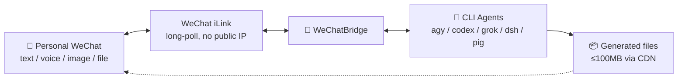

<div align="center">

<picture>
  <source media="(prefers-color-scheme: dark)" srcset="https://raw.githubusercontent.com/dorokuma/wechatbridge/main/assets/logo-dark.svg">
  <source media="(prefers-color-scheme: light)" srcset="https://raw.githubusercontent.com/dorokuma/wechatbridge/main/assets/logo-light.svg">
  
</picture>

# WeChatBridge

**Talk to your terminal coding agent right from personal WeChat — scan a QR code, zero public IP, zero enterprise account needed.**

[](https://pypi.org/project/wechatbridge-cli/)
[](https://www.python.org/)
[](https://github.com/dorokuma/wechatbridge/actions/workflows/tests.yml)
[](https://github.com/dorokuma/wechatbridge/blob/main/LICENSE)

[Quick Start](#quick-start) · [Highlights](#highlights) · [Commands](#chat-commands) · [Configuration](#more-details) · [简体中文](https://github.com/dorokuma/wechatbridge/blob/main/README.zh-CN.md)

</div>

WeChatBridge runs in the background and keeps long-polling WeChat for new messages through Tencent's official iLink channel. When a message needs the AI, it starts your CLI once, waits for the answer, then closes it again. Most slash commands like `/help`, `/backend`, or `/persona` are answered by the bridge itself; a few like `/model` or `/agents` may query the CLI, and `/agent` runs a real task.



<a id="highlights"></a>

## Highlights

| | |
|---|---|
| 📱 **Scan & connect in seconds** | Official iLink long-poll on your personal WeChat — free, no public IP, no enterprise WeChat account |
| 🔀 **5 backends, hot-swap** | `/backend` switches `agy` / `codex` / `grok` / `dsh` / `pig` at runtime — no restart, per-user workspace & history |
| 🎤 **Full duplex media** | Voice auto-transcribed; images/files fed straight to the agent; generated files come back over encrypted CDN (100MB cap) |
| 🛡️ **Danger gate** | Your *prompt* is keyword-checked (`rm -rf /`, `mkfs`…) and needs a confirm token before it runs — it does not gate the agent's own tool calls afterward, so trusted users only |
| ⚡ **Concurrent & RAM-friendly** | Per-user serial queue, global concurrency cap, built-in systemd cgroup memory-limit template |
| 🐍 **One `pip` away** | Plain Python — `pipx` / `uv` or run from source; expired QR codes auto-refresh without exiting |

## Quick Start

About 30 seconds of commands — then scan a QR code and you're chatting.

**1. Install** (Python 3.10+, [pipx](https://pypa.github.io/pipx/) recommended):

```bash
pipx install wechatbridge-cli
wechatbridge --version
```

**2. Configure `.env`** — pick at least one backend CLI and sign into it (`grok login`, `codex login`, `dsh login`, or `MAGPIE_API_KEY` for pig; `agy` is the default and needs no config):

```bash
mkdir -p ~/.config/wechatbridge
curl -o ~/.config/wechatbridge/.env https://raw.githubusercontent.com/dorokuma/wechatbridge/main/deploy/wechatbridge.env.example
# if your backend isn't agy:
echo 'WECHATBRIDGE_BACKEND=grok' >> ~/.config/wechatbridge/.env   # or codex / dsh / pig
```

> [!TIP]
> The whitelist is on by default: with both `WECHATBRIDGE_ALLOWED_SENDERS` and `WECHATBRIDGE_ADMINS` empty, everyone is denied. For your first run set `WECHATBRIDGE_ALLOWED_SENDERS=*`, send the bot a message, grab your sender ID (`from=<id>`) from the log, then replace `*` with your own wxid and restart.

**3. Run & scan** — the QR code prints right in your terminal; scan it with WeChat and start chatting. If the code expires, the bridge fetches a fresh one automatically and keeps waiting:

```bash
wechatbridge
```

<a id="chat-commands"></a>

## Chat Commands

Send these in WeChat; most are answered by the bridge itself — `/model`, `/models`, `/agents` may query the CLI, and `/agent` runs a real task.

| Command | What it does |
|---|---|
| `/help` | List commands supported by your current backend |
| `/backend agy\|codex\|grok\|dsh\|pig` | Switch agent (no arg = show current); a real switch starts a fresh session |
| `/model <name>` | Change model — validated against the CLI's live list (`/models` to browse); pig: `gemini-web/gemini-4-neon` + `:low/:medium/:high` |
| `/new` or `/clear` | Start a fresh conversation |
| `/fast`, `/planning` | Toggle low-effort / planning mode (`on`/`off`, bare repeats flip it) |
| `/persona <text>` | Set your agent persona (`show` / `clear` / `reset`) |
| `/add-dir <path>` | Grant the agent extra working directories (agy/codex/pig) |
| `/agents` | List available agents — agy/grok query the CLI; codex/pig return a note; not supported on dsh |
| `/version` | Show version, instance and backend + upgrade hint |
| `/price <link/keyword>` | Optional JD/Taobao coupon & price lookup (needs `JDUNION_*` or `DATAOKE_*` keys) |
| `/mcp`, `/agent <name> <task>` | Extension-tool usage hint / rewrite your request into a subagent prompt |

Unsupported or TUI-only commands either get a polite refusal or are passed through to the CLI.

<a id="more-details"></a>

## More Details

Everything else you might need, tucked away.

<a id="backend-setup"></a>

<details>
<summary><b>Backend Setup (agy / codex / grok / dsh / pig)</b></summary>

Install at least one backend CLI and sign in once on the host. `agy` is the default; switch anytime per user with `/backend`, or set the global default with `WECHATBRIDGE_BACKEND`.

| Backend | CLI | Auth | Notes |
|---|---|---|---|
| **agy** (default) | [Antigravity CLI](https://antigravity.google/docs/cli) | `agy` login on host | Author's daily driver |
| **pig** | pig CLI | `WECHATBRIDGE_MAGPIE_API_KEY` or `MAGPIE_API_KEY` | Magpie-backed, single model `gemini-web/gemini-4-neon`; no interactive login; author's daily driver |
| **codex** | [Codex CLI](https://developers.openai.com/codex/cli) | `codex login` (or `CODEX_API_KEY`) | Implemented & tested; verify in your own setup |
| **grok** | [Grok Build](https://docs.x.ai/build/overview) | `grok login` (or `XAI_API_KEY`) | Implemented & tested; verify in your own setup |
| **dsh** | [DeepSeek Harness](https://github.com/deepseek-ai/deepseek-harness/blob/master/apps/cli/README.md) | `dsh login` | Contributed by [@KOP-XIAO](https://github.com/dorokuma/wechatbridge/pull/3) & verified on real hardware; needs `PyYAML`; windowed memory by default or true persistent sessions via `WECHATBRIDGE_DSH_RESUME=true` + the `dsh-bridge-runner` plugin in your own headless profile (not shipped) |

Key env knobs: `AGY_BIN_PATH` / `GROK_BIN_PATH` / `CODEX_BIN_PATH` / `DSH_BIN_PATH` / `PIG_BIN_PATH` (binary paths), `AGY_TIMEOUT` / `DSH_TIMEOUT` / `PIG_TIMEOUT` (run timeouts), `WECHATBRIDGE_MAGPIE_BASE_URL` (pig upstream, `https://` or loopback only), `WECHATBRIDGE_DSH_HOME` / `WECHATBRIDGE_HOST_HOME` (credential & profile home resolution for service-user deployments).

Each WeChat user runs with `HOME` pointed at their own session directory — model, effort, mode and persona are remembered per backend; auth files like `~/.codex/auth.json` are symlinked in from the host and atomically copied back when the CLI refreshes them, so renewed tokens are never clobbered.

</details>

<a id="env-vars"></a>

<details>
<summary><b>Full Environment Variables</b></summary>

Config file load order: `$WECHATBRIDGE_ENV_FILE` → `$XDG_CONFIG_HOME/wechatbridge/<instance>.env` → `$XDG_CONFIG_HOME/wechatbridge/.env` → repo-root `.env` (deprecated). Full annotated list: [`deploy/wechatbridge.env.example`](https://github.com/dorokuma/wechatbridge/blob/main/deploy/wechatbridge.env.example).

| Variable | Default | Purpose |
|---|---|---|
| `AGY_BIN_PATH` | `agy` | path to the agy binary |
| `GROK_BIN_PATH` | `grok` | path to the grok binary |
| `CODEX_BIN_PATH` | `codex` | path to the codex binary |
| `DSH_BIN_PATH` | `dsh` | path to the dsh binary |
| `PIG_BIN_PATH` | `pig` | path to the pig binary |
| `PIG_TIMEOUT` | `570` | pig CLI run timeout in seconds (aligned with the Magpie upstream stream deadline) |
| `WECHATBRIDGE_MAGPIE_BASE_URL` | _built-in_ | Magpie OpenAI-compatible base URL for pig; unset falls back to the built-in upstream (only `https://` or loopback `http://` allowed) |
| `WECHATBRIDGE_MAGPIE_API_KEY` | _empty_ | Magpie API key for pig (also read from `MAGPIE_API_KEY`; injected into the pig child, never persisted) |
| `DSH_PROFILE` | `headless` | dsh profile booted for one-shot tasks |
| `DSH_TIMEOUT` | `600` | dsh CLI run timeout in seconds |
| `WECHATBRIDGE_DSH_MEMORY_TURNS` | `10` | dsh backend: recent user+assistant turns injected as context |
| `WECHATBRIDGE_DSH_MEMORY_CHARS` | `6000` | dsh backend: max chars of injected memory context |
| `WECHATBRIDGE_DSH_RESUME` | `false` | dsh backend: true persistent-session mode (one resumed session per user); requires the dsh-bridge-runner plugin in the headless profile; skips windowed memory |
| `WECHATBRIDGE_DSH_HOME` | _empty_ | explicit `DSH_HOME` for the dsh child; set = dedicated home + auto session cleanup, unset = fall back to `WECHATBRIDGE_HOST_HOME/.dsh` or `~/.dsh` |
| `WECHATBRIDGE_HOST_HOME` | _empty_ | host home override for service-user deployments; fallback base for `~/.grok`, `~/.codex`, `~/.dsh` |
| `WECHATBRIDGE_DSH_STATE_DIR` | _derived_ | bridge-private dsh state dir (memory JSONL + persistent session IDs; default `~/.local/share/wechatbridge/<instance>/dsh_state`) |
| `WECHATBRIDGE_BACKEND` | `agy` | global default backend (`agy` / `grok` / `codex` / `dsh` / `pig`; `/backend` overrides per user) |
| `WECHATBRIDGE_INSTANCE` | `default` | instance name; state / session / QR paths derive from it |
| `WECHATBRIDGE_ALLOWED_SENDERS` | _empty_ | comma-separated WeChat IDs; `*` = allow all; empty = only `WECHATBRIDGE_ADMINS` users (deny all if that is empty too) |
| `AGY_TIMEOUT` | `600` | CLI run timeout in seconds (agy / grok / codex) |
| `WECHATBRIDGE_MAX_OUTBOUND_BYTES` | `104857600` | max file size sent back to WeChat (100 MB) |
| `WECHATBRIDGE_MAX_INBOUND_BYTES` | `20971520` | max inbound image/file after download (20 MB) |
| `WECHATBRIDGE_MAX_CONCURRENT` | `4` | global concurrent process slots; same user serial (queue does not hold a slot); extras get a busy reply — on small-RAM hosts lower this before raising memory caps |
| `WECHATBRIDGE_QUEUE_NOTICE` | `true` | one-shot "queued" notice when the user's previous message is still running |
| `WECHATBRIDGE_PROGRESS_NOTICE` | `true` | one-shot "still working" notice after `WECHATBRIDGE_PROGRESS_NOTICE_DELAY` |
| `WECHATBRIDGE_PROGRESS_NOTICE_DELAY` | `30` | seconds before the progress notice fires |
| `WECHATBRIDGE_CONFIRM_TOKEN` | `y` | reply this token to approve a gated dangerous prompt |
| `WECHATBRIDGE_ENABLE_MCP` | `true` | enable the `/mcp` help-text command |
| `WECHATBRIDGE_ENABLE_SUBAGENT` | `true` | enable the `/agent` prompt-rewrite command |
| `WECHATBRIDGE_ADMINS` | _empty_ | comma-separated wxid list; admins get a WeChat ping when a new version is detected |
| `WECHATBRIDGE_UPDATE_CHECK` | `true` | check PyPI for new versions on startup and every 24h; failures are silent |
| `WECHATBRIDGE_UPDATE_CHECK_INTERVAL` | `86400` | update check interval in seconds |

</details>

<a id="deployment"></a>

<details>
<summary><b>Production Deployment (systemd & Memory Limits)</b></summary>

**Upgrade an existing install:**

```bash
pipx upgrade wechatbridge-cli
sudo systemctl restart wechatbridge
# or via the deploy script — it upgrades and restarts for you:
curl -fsSL https://raw.githubusercontent.com/dorokuma/wechatbridge/main/deploy/update.sh | sudo bash
```

Your data (`~/.local/share/wechatbridge/<instance>/`: sessions, SQLite history, QR codes, login state) is never touched by upgrades. Before a **major** or **minor** bump, check [`CHANGELOG.md`](https://github.com/dorokuma/wechatbridge/blob/main/CHANGELOG.md) for breaking changes.

**Linux (systemd):**

Fetch the unit files first — either clone the repo or download them straight into place:

```bash
# option A: clone the repo
git clone https://github.com/dorokuma/wechatbridge.git && cd wechatbridge

# option B: download just the unit files
sudo curl -fsSL -o /etc/systemd/system/wechatbridge.service \
  https://raw.githubusercontent.com/dorokuma/wechatbridge/main/deploy/wechatbridge.service
sudo curl -fsSL -o /etc/systemd/system/wechatbridge@.service \
  https://raw.githubusercontent.com/dorokuma/wechatbridge/main/deploy/wechatbridge@.service
```

```bash
sudo -u wechatbridge pipx install wechatbridge-cli
sudo cp deploy/wechatbridge.service /etc/systemd/system/   # option A only
sudo systemctl enable --now wechatbridge
```

**Multi-instance** — one process per WeChat binding, each with its own config & data dir:

```bash
sudo cp deploy/wechatbridge@.service /etc/systemd/system/   # option A; option B already placed it
sudo systemctl enable --now wechatbridge@bot2   # reads ~/.config/wechatbridge/bot2.env
```

Drop each instance's `<name>.env` into the **service user's** config dir (`~/.config/wechatbridge/` for the account the unit runs as).

The bundled units ship cgroup memory limits tuned for small hosts:

```ini
MemoryAccounting=yes
MemoryHigh=450M
MemoryMax=512M
```

- **Why these numbers:** a backend child like `agy` can peak at ~276 MB+ RSS per turn; on a ~1 GB host a hard 300 MB cap causes swap thrashing and breaks streaming. `450M` reclaims gently, `512M` is the OOM-safe ceiling. Budget N × `MemoryMax` across all running instances.
- **Override per instance** with a drop-in (no template edits):

  ```bash
  sudo mkdir -p /etc/systemd/system/wechatbridge@bot2.service.d/
  cat << 'EOF' | sudo tee /etc/systemd/system/wechatbridge@bot2.service.d/memory.conf
  [Service]
  # hosts with >= 2 GB RAM
  MemoryHigh=600M
  MemoryMax=768M
  EOF
  sudo systemctl daemon-reload && sudo systemctl restart wechatbridge@bot2
  systemctl show wechatbridge@bot2 -p MemoryHigh,MemoryMax
  ```
- **Interplay:** heavy concurrent turns multiply child memory — on small hosts lower `WECHATBRIDGE_MAX_CONCURRENT` before raising caps. Don't tighten `MemorySwapMax`; swap headroom degrades gracefully instead of OOM-killing. Single-instance deployments use the same built-in limits via `/etc/systemd/system/wechatbridge.service.d/`. cgroup caps exist only on Linux — macOS launchd and Windows Task Scheduler have no equivalent.

**macOS (launchd):**

```bash
# A. From a repo clone:
mkdir -p ~/Library/LaunchAgents && cp deploy/wechatbridge.plist ~/Library/LaunchAgents/com.wechatbridge.plist
# B. No clone (e.g. pipx install) — fetch the plist instead:
mkdir -p ~/Library/LaunchAgents && curl -fsSL -o ~/Library/LaunchAgents/com.wechatbridge.plist https://raw.githubusercontent.com/dorokuma/wechatbridge/main/deploy/wechatbridge.plist
# edit WorkingDirectory and ProgramArguments
launchctl load ~/Library/LaunchAgents/com.wechatbridge.plist
```

**Windows:** see [`deploy/wechatbridge-windows.md`](https://github.com/dorokuma/wechatbridge/blob/main/deploy/wechatbridge-windows.md).

</details>

<a id="security-notes"></a>

<details>
<summary><b>Security & Architecture Notes</b></summary>

What the bridge actually enforces — read this before exposing it to anyone:

- **Whitelist first.** Empty `WECHATBRIDGE_ALLOWED_SENDERS` + empty `WECHATBRIDGE_ADMINS` = nobody gets in. `*` is first-run debugging only.
- **Auto-approve CLIs.** agy runs with `--dangerously-skip-permissions`, grok with `--always-approve` (unless planning mode), dsh tools have no host path restrictions. Only give this bot to people you trust — it is not a multi-tenant sandbox.
- **The danger gate matches keywords**, not intent. Defaults catch `rm -rf /`, pipe-to-shell, `mkfs`, `format c:` and a few heavy Chinese phrases — a bare "delete" is *not* gated. Customize via `WECHATBRIDGE_CONFIRM_KEYWORDS`; confirm with `WECHATBRIDGE_CONFIRM_TOKEN` (default `y`) within `WECHATBRIDGE_PENDING_TTL`.
- **Inbound media:** size-capped (default 20 MB), streamed, CDN hosts allowlisted, AES-128-ECB decrypt; a missing `aes_key` returns a clear error.
- **Outbound artifacts:** only from the allowed per-user tree, `realpath`-checked, capped at `WECHATBRIDGE_MAX_OUTBOUND_BYTES`. The credential scanner also blocks files containing host OAuth tokens or `MAGPIE_API_KEY` material.
- **Concurrency:** global slot cap (`WECHATBRIDGE_MAX_CONCURRENT`, default 4); a queued message does not hold a slot, different users run in parallel.
- **Isolation:** each user's child runs with `HOME` (and `USERPROFILE` on Windows) pointed at their session dir; common secret-style env vars are stripped before spawning.
- **Retention:** session temps and dialogue history use separate TTLs (`WECHATBRIDGE_SESSION_RETENTION_DAYS`, `WECHATBRIDGE_HISTORY_RETENTION_DAYS`); prefs and auth survive. Runtime dirs prefer `0700`, token/QR files `0600` (Unix; Windows relies on NTFS ACLs).
- **Long replies** are chunked (`WECHATBRIDGE_MESSAGE_CHUNK`, default 2000 chars).
- **dsh-specific:** private state (`dsh_memory.jsonl`, session IDs) lives outside the child session tree so one-level `../` can't reach it — but two-level traversal still can, and that is accepted on purpose. Same trust model: trusted users only.

**Known limitations:** not a standalone agent (you need at least one backend CLI); voice is WeChat-side transcription only; no video, no native voice-bubble replies; one WeChat binding per process (multi-account = multi-instance); artifact send-back is best-effort within allowed paths; `/mcp`/`/agent` are guidance, not an in-bridge MCP host; dsh's `/model`/`/fast`/`/planning`/`/persona`/`/add-dir` are not wired yet.

</details>

## Platform Support

| Platform | Status | Notes |
|---|---|---|
| Linux | Primary | systemd units + cgroup memory limits included |
| macOS | Supported | launchd plist included |
| Windows | Supported | Task Scheduler guide included |

Default data paths expand from `~` (e.g. `~/.local/share/wechatbridge/<instance>/`).

## Contributors

- [@KOP-XIAO](https://github.com/KOP-XIAO) — the dsh backend ([#3](https://github.com/dorokuma/wechatbridge/pull/3)) and its long-term memory plus resume support ([#4](https://github.com/dorokuma/wechatbridge/pull/4)), verified on real hardware.

## Contributing

See [`CONTRIBUTING.md`](https://github.com/dorokuma/wechatbridge/blob/main/CONTRIBUTING.md). Versions follow SemVer; changes go into [`CHANGELOG.md`](https://github.com/dorokuma/wechatbridge/blob/main/CHANGELOG.md).

## License

[MIT](https://github.com/dorokuma/wechatbridge/blob/main/LICENSE)
