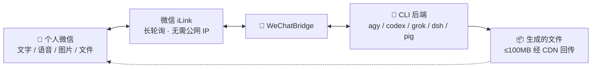

<div align="center">

<picture>
  <source media="(prefers-color-scheme: dark)" srcset="https://raw.githubusercontent.com/dorokuma/wechatbridge/main/assets/logo-dark.svg">
  <source media="(prefers-color-scheme: light)" srcset="https://raw.githubusercontent.com/dorokuma/wechatbridge/main/assets/logo-light.svg">
  
</picture>

# WeChatBridge

**在个人微信里直接指挥你的终端 AI 编程助手——扫码即连，不需要公网 IP，也不需要企业微信。**

[](https://pypi.org/project/wechatbridge-cli/)
[](https://www.python.org/)
[](https://github.com/dorokuma/wechatbridge/actions/workflows/tests.yml)
[](https://github.com/dorokuma/wechatbridge/blob/main/LICENSE)

[快速开始](#快速开始) · [核心特性](#核心特性) · [常用指令](#常用指令) · [更多配置](#更多配置与运维) · [English](README.md)

</div>

WeChatBridge 在后台常驻，通过腾讯官方 iLink 通道长轮询收消息。你发的内容需要 AI 处理时，它才把 CLI 拉起一次，拿到答案再关掉。`/help`、`/backend`、`/persona` 这类控制指令由桥自己应答；少数如 `/model`、`/agents` 会按需调起 CLI 查询，`/agent` 则会触发一次真实任务执行。



<a id="核心特性"></a>

## 核心特性

| | |
|---|---|
| 📱 **扫码即连** | 官方 iLink 长轮询，个人微信直接用——免费、零公网 IP、零企业微信资质 |
| 🔀 **5 套后端热切换** | `/backend` 在 `agy` / `codex` / `grok` / `dsh` / `pig` 间秒切——免重启，工作区与历史按微信用户隔离 |
| 🎤 **全媒体双向收发** | 语音自动转文字、图片/文件直喂 Agent、AI 生成的文件经加密 CDN 自动发回微信（默认上限 100MB） |
| 🛡️ **高危命令闸门** | 仅对**你发的 prompt** 做关键词检查（`rm -rf /`、`mkfs`…），命中需回复确认口令才放行——不拦截 Agent 随后自行发起的工具执行，只适合可信用户 |
| ⚡ **并发与小内存友好** | 单用户串行队列、全局并发上限、内置 systemd cgroup 内存保护模板 |
| 🐍 **一条命令装好** | 纯 Python，`pipx` / `uv` 或源码启动都行；二维码过期自动刷新不退出 |

## 快速开始

命令不到 30 秒，扫个码就能聊。

**1. 安装**（需 Python 3.10+，推荐 [pipx](https://pypa.github.io/pipx/)）：

```bash
pipx install wechatbridge-cli
wechatbridge --version
```

**2. 配置 `.env`** —— 选一个后端 CLI 装好并登录一次（`grok login`、`codex login`、`dsh login`，或给 pig 配 `MAGPIE_API_KEY`；默认 `agy`，不用额外配置）：

```bash
mkdir -p ~/.config/wechatbridge
curl -o ~/.config/wechatbridge/.env https://raw.githubusercontent.com/dorokuma/wechatbridge/main/deploy/wechatbridge.env.example
# 如果用的不是 agy：
echo 'WECHATBRIDGE_BACKEND=grok' >> ~/.config/wechatbridge/.env   # 或 codex / dsh / pig
```

> [!TIP]
> 白名单默认是开着的：`WECHATBRIDGE_ALLOWED_SENDERS` 和 `WECHATBRIDGE_ADMINS` 都为空时会拒绝所有人。第一次跑先设 `WECHATBRIDGE_ALLOWED_SENDERS=*`，给 bot 发条消息，从日志里找到自己的发送者 ID（`from=<id>`），再把 `*` 换成你的 wxid 并重启。

**3. 启动扫码** —— 二维码直接打在终端里，微信扫完就能聊。码过期了桥会自动拿新的继续等，不用重启：

```bash
wechatbridge
```

<a id="常用指令"></a>

## 常用指令

直接在微信里发。大多数由桥自己应答；`/model`、`/models`、`/agents` 会按需调起 CLI 查询，`/agent` 会跑一次真实任务。

| 指令 | 作用 |
|---|---|
| `/help` | 列出当前后端支持的指令 |
| `/backend agy\|codex\|grok\|dsh\|pig` | 切换引擎（不带参数查看当前）；真切换会起新会话 |
| `/model <名称>` | 换模型——对照 CLI 实时列表校验（`/models` 看可用项）；pig 固定 `gemini-web/gemini-4-neon`，可加 `:low/:medium/:high` 调思考强度 |
| `/new` 或 `/clear` | 开新对话 |
| `/fast`、`/planning` | 低推理开销 / 只读规划模式开关（可带 `on`/`off`，无参再按一次关闭） |
| `/persona <内容>` | 设助手人格（`show` / `clear` / `reset`） |
| `/add-dir <路径>` | 给 Agent 追加可用目录（agy/codex/pig） |
| `/agents` | 列出可用助手——agy/grok 调起 CLI 查询；codex/pig 返回说明；dsh 不支持 |
| `/version` | 查看版本、实例名和后端，有新版本会提示 |
| `/price <链接/词>` | 可选：京东/淘宝查券比价（需配 `JDUNION_*` 或 `DATAOKE_*`） |
| `/mcp`、`/agent <名称> <任务>` | 扩展工具用法说明 / 把请求改写成子助手提示 |

不支持或 TUI 专用的指令，要么礼貌回绝，要么透传给 CLI。

<a id="更多配置与运维"></a>

## 更多配置与运维

剩下的都在这儿，折叠好了。

<a id="各后端配置说明"></a>

<details>
<summary><b>各后端配置说明（agy / codex / grok / dsh / pig）</b></summary>

至少装一个后端 CLI 并在宿主机登录一次。默认 `agy`；随时可在微信里用 `/backend` 按用户切换，全局默认用 `WECHATBRIDGE_BACKEND` 设。

| 后端 | CLI | 认证 | 说明 |
|---|---|---|---|
| **agy**（默认） | [Antigravity CLI](https://antigravity.google/docs/cli) | 宿主机 `agy` 登录 | 作者日常在用 |
| **pig** | pig CLI | `WECHATBRIDGE_MAGPIE_API_KEY` 或 `MAGPIE_API_KEY` | Magpie 上游单模型 `gemini-web/gemini-4-neon`，无需交互登录；作者日常在用 |
| **codex** | [Codex CLI](https://developers.openai.com/codex/cli) | `codex login`（或 `CODEX_API_KEY`） | 已实现并有测试，依赖前请先自行实测 |
| **grok** | [Grok Build](https://docs.x.ai/build/overview) | `grok login`（或 `XAI_API_KEY`） | 已实现并有测试，依赖前请先自行实测 |
| **dsh** | [DeepSeek Harness](https://github.com/deepseek-ai/deepseek-harness/blob/master/apps/cli/README.md) | `dsh login` | 由 [@KOP-XIAO](https://github.com/dorokuma/wechatbridge/pull/3) 贡献并在真机验证；需要 `PyYAML`；默认窗口记忆，也可 `WECHATBRIDGE_DSH_RESUME=true` 开启常驻会话（需在自己的 headless profile 挂载 `dsh-bridge-runner` 插件，本仓库不附带） |

常用环境变量：`AGY_BIN_PATH` / `GROK_BIN_PATH` / `CODEX_BIN_PATH` / `DSH_BIN_PATH` / `PIG_BIN_PATH`（二进制路径）、`AGY_TIMEOUT` / `DSH_TIMEOUT` / `PIG_TIMEOUT`（执行超时）、`WECHATBRIDGE_MAGPIE_BASE_URL`（pig 上游，仅允许 `https://` 或回环 `http://`）、`WECHATBRIDGE_DSH_HOME` / `WECHATBRIDGE_HOST_HOME`（服务用户部署时的凭证与 profile 目录解析）。

每个微信用户运行时 `HOME` 指到自己的会话目录——模型、推理强度、模式和人格按后端分别记忆；`~/.codex/auth.json` 这类凭证以软链挂进会话目录，CLI 刷新 token 时桥会原子写回宿主，新凭证不会被旧副本覆盖。

</details>

<a id="完整环境变量表"></a>

<details>
<summary><b>完整环境变量表</b></summary>

配置文件加载顺序：`$WECHATBRIDGE_ENV_FILE` → `$XDG_CONFIG_HOME/wechatbridge/<实例名>.env` → `$XDG_CONFIG_HOME/wechatbridge/.env` → 仓库根目录 `.env`（已废弃）。带注释的完整清单：[`deploy/wechatbridge.env.example`](deploy/wechatbridge.env.example)。

| 变量 | 默认值 | 用途 |
|---|---|---|
| `AGY_BIN_PATH` | `agy` | agy 可执行文件路径 |
| `GROK_BIN_PATH` | `grok` | grok 可执行文件路径 |
| `CODEX_BIN_PATH` | `codex` | codex 可执行文件路径 |
| `DSH_BIN_PATH` | `dsh` | dsh 可执行文件路径 |
| `PIG_BIN_PATH` | `pig` | pig 可执行文件路径 |
| `PIG_TIMEOUT` | `570` | pig CLI 执行超时秒数（对齐 Magpie 上游流式截止） |
| `WECHATBRIDGE_MAGPIE_BASE_URL` | _内置_ | pig 后端的 Magpie OpenAI-compatible base URL；未设时使用内置上游（仅允许 `https://` 或回环 `http://`） |
| `WECHATBRIDGE_MAGPIE_API_KEY` | _空_ | pig 后端的 Magpie API key（也读 `MAGPIE_API_KEY`；注入 pig 子进程，不落盘） |
| `DSH_PROFILE` | `headless` | dsh 单轮任务启动的 profile |
| `DSH_TIMEOUT` | `600` | dsh CLI 执行超时秒数 |
| `WECHATBRIDGE_DSH_MEMORY_TURNS` | `10` | dsh 后端：注入上下文的最近对话轮数（user+assistant 对） |
| `WECHATBRIDGE_DSH_MEMORY_CHARS` | `6000` | dsh 后端：注入记忆上下文的字符上限 |
| `WECHATBRIDGE_DSH_RESUME` | `false` | dsh 后端：常驻会话模式（每用户一个会话持续恢复）；需在 headless profile 挂载 dsh-bridge-runner 插件；启用时跳过窗口记忆 |
| `WECHATBRIDGE_DSH_HOME` | _空_ | 传给 dsh 子进程的显式 `DSH_HOME`；显式设置 = 专用目录+自动会话清理，未设 = 回退 `WECHATBRIDGE_HOST_HOME/.dsh` 或 `~/.dsh` |
| `WECHATBRIDGE_HOST_HOME` | _空_ | 宿主主目录覆盖（服务用户部署用）；`~/.grok`、`~/.codex`、`~/.dsh` 的回退基准 |
| `WECHATBRIDGE_DSH_STATE_DIR` | _派生_ | 桥私有 dsh 状态目录（记忆 JSONL 与持久会话 ID；默认 `~/.local/share/wechatbridge/<实例名>/dsh_state`） |
| `WECHATBRIDGE_BACKEND` | `agy` | 全局默认后端（`agy` / `grok` / `codex` / `dsh` / `pig`，可被 `/backend` 按用户覆盖） |
| `WECHATBRIDGE_INSTANCE` | `default` | 实例名；state / 会话 / 二维码路径由它派生 |
| `WECHATBRIDGE_ALLOWED_SENDERS` | _空_ | 允许使用的微信 ID，逗号分隔；`*` = 全开；空 = 仅 `WECHATBRIDGE_ADMINS` 成员（管理员也为空则拒绝所有人） |
| `AGY_TIMEOUT` | `600` | CLI 执行超时秒数（agy / grok / codex） |
| `WECHATBRIDGE_MAX_OUTBOUND_BYTES` | `104857600` | 回传微信文件大小上限（100 MB） |
| `WECHATBRIDGE_MAX_INBOUND_BYTES` | `20971520` | 入站图片/文件下载后上限（20 MB） |
| `WECHATBRIDGE_MAX_CONCURRENT` | `4` | 全局并发处理上限；同用户串行且排队不占槽；满了回「忙」——小内存主机调大内存上限前先调小此项 |
| `WECHATBRIDGE_QUEUE_NOTICE` | `true` | 同用户上一条仍在处理时发一次「已加入排队」提示 |
| `WECHATBRIDGE_PROGRESS_NOTICE` | `true` | 处理超过 `WECHATBRIDGE_PROGRESS_NOTICE_DELAY` 秒发一次「仍在处理中」提示 |
| `WECHATBRIDGE_PROGRESS_NOTICE_DELAY` | `30` | 进度提示触发阈值（秒） |
| `WECHATBRIDGE_CONFIRM_TOKEN` | `y` | 危险闸门确认口令 |
| `WECHATBRIDGE_ENABLE_MCP` | `true` | 是否启用 `/mcp` 说明指令 |
| `WECHATBRIDGE_ENABLE_SUBAGENT` | `true` | 是否启用 `/agent` 提示改写指令 |
| `WECHATBRIDGE_ADMINS` | _空_ | 逗号分隔的 wxid 列表；检测到新版本时管理员收到微信通知 |
| `WECHATBRIDGE_UPDATE_CHECK` | `true` | 启动时及每 24h 检查 PyPI 新版本；失败静默不影响运行 |
| `WECHATBRIDGE_UPDATE_CHECK_INTERVAL` | `86400` | 版本检查间隔（秒） |

</details>

<a id="生产部署"></a>

<details>
<summary><b>生产部署（systemd 与内存限制）</b></summary>

**升级已有安装：**

```bash
pipx upgrade wechatbridge-cli
sudo systemctl restart wechatbridge
# 或用部署脚本一键升级并重启：
curl -fsSL https://raw.githubusercontent.com/dorokuma/wechatbridge/main/deploy/update.sh | sudo bash
```

数据放在 `~/.local/share/wechatbridge/<实例名>/`（会话、SQLite 历史、二维码、登录态），升级不动它。升 **major** 或 **minor** 前，先查 [`CHANGELOG.md`](CHANGELOG.md) 里的破坏性变更。

**Linux（systemd）：**

先拿到 unit 文件——克隆仓库或直接下载到位：

```bash
# 方式 A：克隆仓库
git clone https://github.com/dorokuma/wechatbridge.git && cd wechatbridge

# 方式 B：只下载 unit 文件
sudo curl -fsSL -o /etc/systemd/system/wechatbridge.service \
  https://raw.githubusercontent.com/dorokuma/wechatbridge/main/deploy/wechatbridge.service
sudo curl -fsSL -o /etc/systemd/system/wechatbridge@.service \
  https://raw.githubusercontent.com/dorokuma/wechatbridge/main/deploy/wechatbridge@.service
```

```bash
sudo -u wechatbridge pipx install wechatbridge-cli
sudo cp deploy/wechatbridge.service /etc/systemd/system/   # 仅方式 A
sudo systemctl enable --now wechatbridge
```

**多实例** —— 一个进程绑一个微信号，各实例读自己的配置、存自己的数据：

```bash
sudo cp deploy/wechatbridge@.service /etc/systemd/system/   # 方式 A；方式 B 已下载到位
sudo systemctl enable --now wechatbridge@bot2   # 读 ~/.config/wechatbridge/bot2.env
```

每个实例的 `<实例名>.env` 放在**服务运行用户**的配置目录下（即该账号的 `~/.config/wechatbridge/`）。

自带 unit 里内置了针对小内存主机调优的 cgroup 限制：

```ini
MemoryAccounting=yes
MemoryHigh=450M
MemoryMax=512M
```

- **为什么是这个数：** `agy` 这类后端子进程单轮 RSS 能到 ~276 MB 以上；在 ~1 GB 内存的主机上给 300 MB 硬顶会剧烈换页、流式中断。`450M` 温和回收，`512M` 防整机 OOM。容量按全部在跑实例的 N × `MemoryMax` 来留。
- **按实例用 drop-in 覆盖**（不动基础模板）：

  ```bash
  sudo mkdir -p /etc/systemd/system/wechatbridge@bot2.service.d/
  cat << 'EOF' | sudo tee /etc/systemd/system/wechatbridge@bot2.service.d/memory.conf
  [Service]
  # 适用于 >= 2 GB 内存的主机
  MemoryHigh=600M
  MemoryMax=768M
  EOF
  sudo systemctl daemon-reload && sudo systemctl restart wechatbridge@bot2
  systemctl show wechatbridge@bot2 -p MemoryHigh,MemoryMax
  ```
- **注意联动：** 多条重型任务并发会成倍放大子进程内存——小内存主机先把 `WECHATBRIDGE_MAX_CONCURRENT` 调小再考虑加内存。别收紧 `MemorySwapMax`，swap 余量是承压时的缓冲。单实例部署用同样的内置上限，drop-in 放 `/etc/systemd/system/wechatbridge.service.d/`。cgroup 上限只有 Linux systemd 有，macOS launchd 和 Windows 任务计划没有等价物。

**macOS（launchd）：**

```bash
# A. 在仓库克隆里执行：
mkdir -p ~/Library/LaunchAgents && cp deploy/wechatbridge.plist ~/Library/LaunchAgents/com.wechatbridge.plist
# B. 未克隆（如 pipx 安装）——直接拉取 plist：
mkdir -p ~/Library/LaunchAgents && curl -fsSL -o ~/Library/LaunchAgents/com.wechatbridge.plist https://raw.githubusercontent.com/dorokuma/wechatbridge/main/deploy/wechatbridge.plist
# 编辑 plist 里的 WorkingDirectory 和 ProgramArguments
launchctl load ~/Library/LaunchAgents/com.wechatbridge.plist
```

**Windows：** 见 [`deploy/wechatbridge-windows.md`](deploy/wechatbridge-windows.md)。

</details>

<a id="安全机制"></a>

<details>
<summary><b>安全机制与架构细节</b></summary>

桥实际管到什么——开放给别人用之前先读这段：

- **白名单优先。** `WECHATBRIDGE_ALLOWED_SENDERS` 和 `WECHATBRIDGE_ADMINS` 都空 = 拒绝所有人。`*` 只用于首次调试。
- **CLI 自动批准。** agy 带 `--dangerously-skip-permissions`，grok 带 `--always-approve`（planning 模式除外），dsh 的工具无宿主路径约束。只给你信任的人用，这不是多租户沙箱。
- **危险闸门是关键词匹配**，不识别意图。默认盯 `rm -rf /`、管道进 shell、`mkfs`、`format c:` 和少量重型中文句式——一个单独的「删除」*不会*拦。列表用 `WECHATBRIDGE_CONFIRM_KEYWORDS` 自定义；确认口令 `WECHATBRIDGE_CONFIRM_TOKEN`（默认 `y`），时限 `WECHATBRIDGE_PENDING_TTL`。
- **入站媒体：** 大小上限（默认 20 MB）、流式下载、CDN 域名白名单、AES-128-ECB 解密；缺 `aes_key` 会明确报错。
- **出站产物：** 只从用户允许目录发出，经 `realpath` 校验，不超过 `WECHATBRIDGE_MAX_OUTBOUND_BYTES`。凭据扫描还会拦下含宿主 OAuth token 或 `MAGPIE_API_KEY` 内容的文件。
- **并发：** 全局槽上限（`WECHATBRIDGE_MAX_CONCURRENT`，默认 4）；排队不占槽，不同用户并行。
- **隔离：** 每个用户的子进程 `HOME`（Windows 另设 `USERPROFILE`）指到其会话目录；常见密钥类环境变量在拉起子进程前剥掉。
- **清理：** 会话临时文件与对话历史用不同 TTL（`WECHATBRIDGE_SESSION_RETENTION_DAYS`、`WECHATBRIDGE_HISTORY_RETENTION_DAYS`）；偏好和登录态不按此删。运行目录倾向 `0700`，token/二维码倾向 `0600`（Unix；Windows 依赖 NTFS ACL）。
- **长回复**按字数切块（`WECHATBRIDGE_MESSAGE_CHUNK`，默认 2000 字符）。
- **dsh 特有：** 私有状态（`dsh_memory.jsonl`、会话 ID）放在子进程会话目录树之外，一级 `../` 摸不到——但两级穿越仍然可达，这是有意接受的。同一信任模型：只给可信用户用。

**已知限制：** 不是独立 agent（至少需要一个后端 CLI）；语音只靠微信转写，没有本地 ASR；不收发视频、不回原生语音气泡；一个进程绑一个微信号（多号 = 多实例）；产物回传是允许路径内的尽力而为；`/mcp`/`/agent` 是引导不是桥内 MCP 宿主；dsh 的 `/model`/`/fast`/`/planning`/`/persona`/`/add-dir` 暂未接通。

</details>

## 平台支持

| 平台 | 状态 | 说明 |
|---|---|---|
| Linux | 主力 | 附 systemd unit 与 cgroup 内存限制 |
| macOS | 支持 | 附 launchd plist |
| Windows | 支持 | 附任务计划说明 |

默认数据路径从 `~` 展开（如 `~/.local/share/wechatbridge/<实例名>/`）。

## 贡献者

- [@KOP-XIAO](https://github.com/KOP-XIAO) — dsh 后端（[#3](https://github.com/dorokuma/wechatbridge/pull/3)）及其长期记忆与 resume 支持（[#4](https://github.com/dorokuma/wechatbridge/pull/4)），并在真机上验证过。

## 贡献

见 [`CONTRIBUTING.md`](CONTRIBUTING.md)。语义化版本，改动记入 [`CHANGELOG.md`](CHANGELOG.md)。

## 许可证

[MIT](LICENSE)
